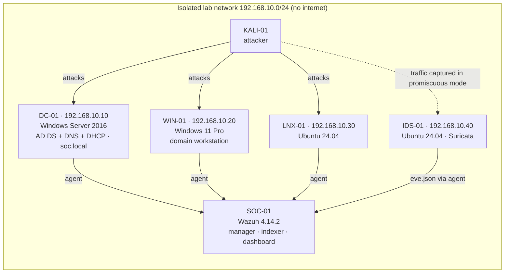
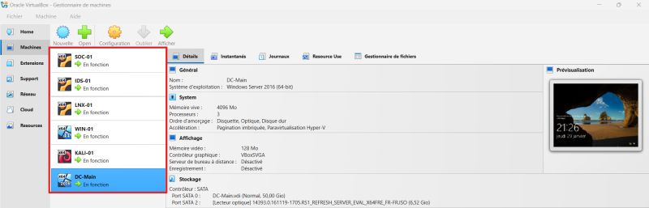
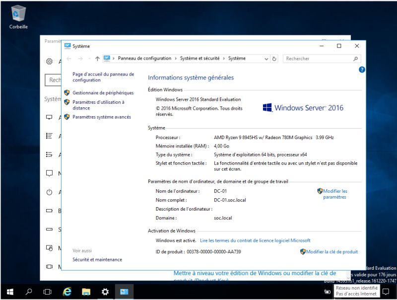
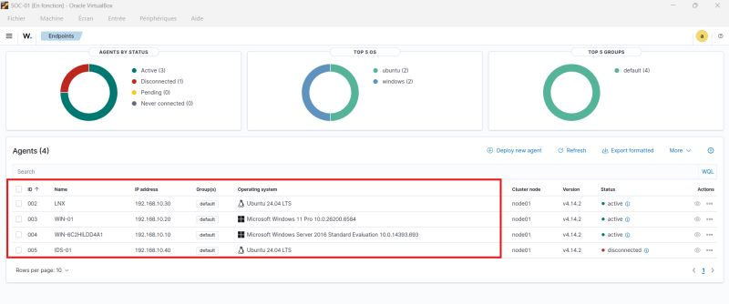

# SOC Home Lab: Detection with Wazuh and Suricata

A virtualized SOC lab where an Active Directory domain is monitored by Wazuh
(SIEM/XDR) and Suricata (network IDS) and attacked from Kali Linux, to practice
detection engineering and alert triage.

## Context and objective

A SOC analyst is only as good as the telemetry and the rules behind each alert.
Reading about Kerberoasting or password spraying is not the same as knowing
which event ID it produces, whether the default audit policy even records it,
and which rule should fire.

This lab reproduces a small corporate network on one laptop so that each
attack technique can be traced end to end: **technique → telemetry → rule →
alert → triage**. It was built while preparing for the Cisco CyberOps
Associate certification.

## Architecture

| VM | Role | OS | IP | Wazuh agent |
| --- | --- | --- | --- | --- |
| SOC-01 | Wazuh all-in-one (manager, indexer, dashboard) | Ubuntu | - | - |
| DC-01 (VM name DC-Main) | Domain controller `soc.local` (AD DS, DNS, DHCP), 3 vCPU, 4 GB RAM, 50 GB | Windows Server 2016 | 192.168.10.10 | 004 |
| WIN-01 | Domain workstation | Windows 11 Pro | 192.168.10.20 | 003 |
| LNX-01 | Linux server (SSH) | Ubuntu 24.04 LTS | 192.168.10.30 | 002 |
| IDS-01 | Suricata network IDS | Ubuntu 24.04 LTS | 192.168.10.40 | 005 |
| KALI-01 | Attacker | Kali Linux | DHCP from DC-01 | - |

Host: one laptop (AMD Ryzen 9 8945HS) running Oracle VirtualBox.

## Technologies

- **Wazuh 4.14.2**: log collection, decoding, detection rules, alerting, dashboards
- **Suricata 7**: network IDS, alerts shipped to Wazuh through `eve.json`
- **Active Directory** on Windows Server 2016: target environment
- **Kali Linux**: attack simulation
- **Oracle VirtualBox**: virtualization, internal network for isolation

## What this project demonstrates

- Building a host and network monitoring stack from scratch: SIEM, agents, IDS
  and log forwarding.
- Writing custom Wazuh rules that chain correctly onto the built-in ruleset,
  with MITRE ATT&CK tags.
- Writing threshold-based Suricata signatures for reconnaissance and
  credential attacks.
- Knowing which Windows audit subcategories must be enabled for each detection
  (Kerberos, credential validation, group management).
- A repeatable triage approach for each alert (scope, source, true or false
  positive, action).

## Technical choices and trade-offs

| Choice | Why | Trade-off |
| --- | --- | --- |
| Wazuh all-in-one on a single VM | The whole lab runs on one laptop; the indexer is the most memory-hungry component, so RAM is planned around SOC-01 first | No high availability and no separation between manager and indexer |
| Dedicated Suricata VM with a promiscuous capture adapter | Sees all traffic on the lab segment without installing anything on the targets | Only sees traffic on that segment; encrypted payloads are not inspected |
| Internal network with no NAT | Attack traffic cannot leave the lab | Packages must be copied in manually; SOC-01 only gets a temporary NAT adapter for the Wazuh install |
| Custom Wazuh rules attached to the most specific built-in rule | Wazuh only follows the first matching child rule, so a rule attached to a generic parent never fires | Each rule depends on built-in rule IDs that can change between Wazuh versions |
| Threshold-based Suricata signatures (SYN counts per source) | Simple and readable, enough to spot a scan or a connection burst | Thresholds are not tuned against a real baseline; a slow scan stays under them |
| User-defined ID ranges (Wazuh 100100-100199, Suricata sid 1000000+) | Avoids collisions with vendor rules on upgrade | None in practice |

## Security

**Threats covered** (details and triage notes in
[`docs/scenarios.md`](docs/scenarios.md)):

| # | Scenario | MITRE ATT&CK | Detection logic |
| --- | --- | --- | --- |
| 1 | Network discovery with Nmap | T1046 | Suricata `sid:1000001` → Wazuh |
| 2 | SSH brute force on LNX-01 | T1110.001 | Wazuh sshd rules 5760 → 5763 (valid user), 5710 → 5712 (unknown user) |
| 3 | RDP / SMB password spraying on domain accounts | T1110.003 | Windows 4625 → Wazuh 60122 → custom rule 100130, Suricata `sid:1000002-3` |
| 4 | Kerberoasting (SPN service account) | T1558.003 | Event 4769 with RC4 → custom rule 100110 |
| 5 | User added to Domain Admins | T1098.007 | Events 4728 / 4732 / 4756 → custom rule 100100 |
| 6 | Security log cleared | T1070.001 | Event 1102 → custom rule 100120 |

**Risks taken into account in the lab itself:**

- Attack traffic stays on an isolated VirtualBox internal network with no
  route to the internet or to the home network.
- No production data and no real credentials are used; the domain
  `soc.local` and all accounts are lab-only.
- This repository only contains rules, configuration snippets and
  documentation. No offensive tooling or payloads are published; the
  playbook stays at the technique level.

## Installation and reproduction

Full build steps are in [`docs/setup.md`](docs/setup.md). In short:

1. Create a VirtualBox internal network `soc-lab` (`192.168.10.0/24`) and the
   six VMs from the table above.
2. Promote DC-01 as the domain controller of `soc.local` and join WIN-01.
3. Install Wazuh all-in-one on SOC-01 and enroll the agents on DC-01, WIN-01,
   LNX-01 and IDS-01.
4. Install Suricata on IDS-01, load [`suricata/local.rules`](suricata/local.rules)
   and forward `eve.json` with
   [`wazuh/ossec-agent-ids.conf`](wazuh/ossec-agent-ids.conf).
5. Apply the Windows advanced audit policy by GPO (section 6 of the setup
   guide).
6. Deploy [`wazuh/local_rules.xml`](wazuh/local_rules.xml) on SOC-01 and
   validate each rule with `wazuh-logtest`.

| Path | Content |
| --- | --- |
| [`docs/setup.md`](docs/setup.md) | Build steps: network, Wazuh, agents, Suricata, audit policy, troubleshooting |
| [`docs/scenarios.md`](docs/scenarios.md) | Scenario playbook: telemetry, ATT&CK mapping, triage notes |
| [`wazuh/local_rules.xml`](wazuh/local_rules.xml) | Custom Wazuh rules for AD attacks |
| [`wazuh/ossec-agent-ids.conf`](wazuh/ossec-agent-ids.conf) | Agent snippet on IDS-01 to forward Suricata alerts |
| [`suricata/local.rules`](suricata/local.rules) | Custom Suricata signatures |
| [`screenshots/`](screenshots) | Lab evidence |

Every push runs a [lint workflow](.github/workflows/lint.yml): Suricata loads
the custom rules in test mode (`suricata -T`), the Wazuh XML files are checked
with `xmllint`, and the Markdown is checked with `markdownlint`.

## Results

Current state of the lab:

- [x] Network and 6 VMs built, isolated from the internet
- [x] AD domain `soc.local` promoted on DC-01
- [x] Wazuh 4.14.2 deployed, 4 agents enrolled (DC-01, WIN-01, LNX-01, IDS-01)
- [ ] Fix IDS-01 agent connectivity (shown *disconnected* in the screenshot)
- [ ] Deploy the custom rules and validate them with `wazuh-logtest`
- [ ] Run the scenarios in [`docs/scenarios.md`](docs/scenarios.md) and add
  the resulting alerts here

| Screenshot | Description |
| --- | --- |
|  | **VirtualBox**: the six lab VMs running (SOC-01, IDS-01, LNX-01, WIN-01, KALI-01, DC-Main). |
|  | **DC-01**: Windows Server 2016 promoted as domain controller of `soc.local`, no internet access. |
|  | **Wazuh 4.14.2**: 4 enrolled agents across Windows and Linux, IDS-01 disconnected at capture time. |

Lessons from the build:

- Default Windows audit policy is not enough. Kerberos, credential validation
  and group management auditing must be enabled by GPO before Wazuh can see
  those attacks.
- Agent names are fixed at enrollment: DC-01 shows as `WIN-6C2HILDD4A1`
  because it was enrolled before the rename.

## Limits and what I would do in production

- **Single node.** Wazuh runs all-in-one with no redundancy. In production the
  indexer would be a cluster, the manager separated, and retention sized
  against the log volume and compliance needs.
- **Rules not yet validated on real events.** The custom rules are written
  against documented event formats but have not been tested with
  `wazuh-logtest` on captured events. In production every rule would ship with
  a sample event and a test, and be deployed through version control.
- **Thresholds not tuned.** Frequencies and timeframes are reasonable defaults,
  not values derived from a baseline. In production they would be tuned
  against several weeks of normal activity to control false positives.
- **Host telemetry is limited to Windows Security and auth logs.** No Sysmon,
  so no process creation or command-line visibility. Production endpoints
  would also have an EDR.
- **Agent enrollment and transport use defaults.** In production enrollment
  would require a password or certificates, and the dashboard would use a
  certificate from the internal PKI instead of the self-signed one.
- **Attack traffic is synthetic and from a single known source.** Real
  detections must also handle distributed sources, VPN users and legitimate
  administrative activity.

## Next steps

- Fix the IDS-01 agent, run the six scenarios and publish the resulting
  alerts with triage notes
- Add Sysmon on WIN-01 and DC-01 for process-level telemetry
- Map every alert to MITRE ATT&CK in a Wazuh dashboard
- Validate the Wazuh rules automatically in CI against sample events
- Document false positives and tune noisy rules

## License

[MIT](LICENSE)
